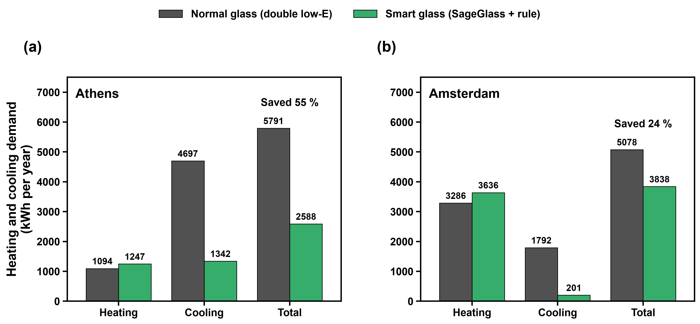
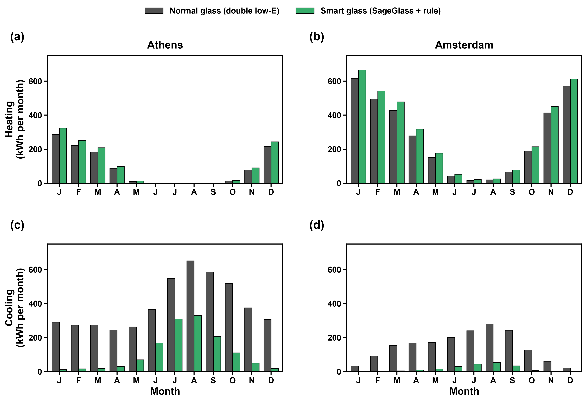
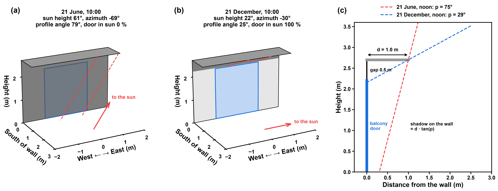

# Smart Window Energy Simulator

**In which climate does a smart (electrochromic) window save more energy, and why?**

This project calculates, hour by hour, the heating and cooling demand of a room with a
south-facing window, using 10 years of real weather data for **Athens** and **Amsterdam**. It compares
a modern normal window with a commercial **electrochromic (EC) window**, which can switch from
clear to tinted when the sun would overheat the room.



*Yearly heating and cooling with normal glass (grey) and smart glass (green), 10-year mean. The smart glass removes most of the cooling in both cities but adds some heating; the saving is much larger in Athens.*

## Main result

The room, the glass and the control rule are the same in both cities; only the weather changes.
Values are the 10-year mean (2014–2023) of the **thermal** energy (heat added or removed), in kWh per year.

| | Athens | Amsterdam |
|---|---|---|
| Mean outdoor temperature | 18.2 °C | 11.3 °C |
| Sun on the south wall | 1305 kWh/m² per year | 943 kWh/m² per year |
| Normal glass: heating + cooling | 1094 + 4697 = **5791** | 3286 + 1792 = **5078** |
| Smart glass: heating + cooling | 1247 + 1342 = **2588** | 3636 + 201 = **3838** |
| **Saved by the smart glass** | **3203 kWh (55 %)** | **1240 kWh (24 %)** |
| – of which May to October | 1731 | 992 |
| Extra heating caused by the smart glass | +152 | +350 |
| Glass tinted (% of daylight hours) | 56 % | 19 % |

All values are rounded to whole numbers, so a total can differ by 1 from the sum of its parts.

**The smart glass saves about 2.6 times more energy in Athens than in Amsterdam.** The window of
the test room can never be opened, which makes both savings larger than in a real home, the
Amsterdam one most of all (see [Limitations](#limitations)). This does not change the answer:
Athens gains more, and in a real home probably by an even larger factor.

### Why (physics interpretation)

- **More sun, more overheating.** The south wall in Athens receives 38 % more sun per year, and the
  air is 7 °C warmer on average. So the room would overheat much more often, and the glass is tinted
  in 56 % of the daylight hours (19 % in Amsterdam). Each tinted hour blocks heat that would
  otherwise have to be removed by cooling.
- **Winter sun is worth more in a cold climate.** A darker glass also blocks useful winter sun, so
  the room needs more heating. This cost is small in Athens (+152 kWh) but more than twice as large
  in Amsterdam (+350 kWh), where heating is the main need.
- **In Amsterdam, being dark all the time does not help.** A glass that is always fully tinted uses
  *more* energy there than one that is always clear (4608 vs 4534 kWh), because the extra heating is
  larger than the cooling saved. Tinting only when it is needed gives a much lower total (3838 kWh).
- **Part of the saving needs no switching.** Even when clear, the smart glass lets in less solar
  heat than the normal glass (SHGC 0.41 vs 0.568). In Athens its clear state alone saves 1385 kWh
  (43 % of the saving), and switching saves the other 1818 kWh. The lower SHGC alone would save
  1471 kWh; the slightly higher U-value of the smart glass and the angle curve we assumed for it
  take back 86 kWh.



*Month by month: heating (a, b) and cooling (c, d). In Athens the smart glass cuts the summer cooling peak; in Amsterdam its extra heating shows in every month.*

### In electricity (illustration only)

Converting heat to electricity needs the efficiency of a heat pump. As an example I use the
minimum values of energy class A++ for air conditioners in the EU [10]: SCOP 4.60 for heating and
SEER 6.10 for cooling (electricity = heating / 4.60 + cooling / 6.10).

| | Athens | Amsterdam |
|---|---|---|
| Normal glass | 1008 kWh | 1008 kWh |
| Smart glass | 491 kWh (−51 %) | 824 kWh (−18 %) |

The two cities give the same 1008 kWh with normal glass by coincidence (Athens needs more cooling,
Amsterdam more heating). SCOP is defined for an average European heating season, so these values are only
an illustration. The electricity used by the smart glass itself to switch is not included.

## How it works

1. **Weather** ([`src/weather.py`](src/weather.py)): hourly sun on a vertical south wall (direct,
   diffuse and ground-reflected) and outdoor temperature, 2014–2023, from PVGIS 5.3 [1].
2. **Sun position** ([`src/sun.py`](src/sun.py)): NOAA equations [2], tested against the sun height given by PVGIS.
3. **Solar heat through the glass** ([`src/window.py`](src/window.py)): SHGC × sun, with the
   SHGC falling at large angles of incidence (curves from ASHRAE Standard 140 [3]).
4. **Room** ([`src/room_model.py`](src/room_model.py)): the "simple hourly method" of
   ISO 13790 [4], [8], a thermal circuit with 5 resistances and 1 capacitor (5R1C), hour by hour.
   Heating starts below 20 °C, cooling above 27 °C.
5. **Smart glass rule** (same file): every hour, if the room with clear glass would become warmer
   than 27 °C, the glass tints for that hour.

The room is **BESTEST Case 600** from ANSI/ASHRAE Standard 140 [3], [5]: a light test room of
8 × 6 × 2.7 m with 12 m² of south window, 200 W of internal gains, and 0.5 air changes per hour.
It is a standard test case, not a real home. I chose it because it is fully defined
and published results exist for it, so the comparison does not depend on my own choices about
the building.

Every equation, assumption and test is written out in **[docs/equations.md](docs/equations.md)**.

### Windows compared

| Glass | U (W/m²K) | State | SHGC | Visible transmittance | Source |
|---|---|---|---|---|---|
| Normal: double glazing, low-E, argon | 1.49 | – | 0.568 | 0.745 | EnergyPlus data set [6] |
| Smart: SageGlass Clear with SR2.0 | 1.65 | clear | 0.41 | 0.60 | SageGlass data sheet [7] |
| | | light tint (used by the rule) | 0.16 | 0.18 | [7] |
| | | full tint (extra case) | 0.09 | 0.01 | [7] |

All values are for the glass only (no frame).

## Validation

The same model was tested on BESTEST Case 600 and Case 610 (with an overhang) in Denver,
the location used by the standard, and compared with the published results of professional
simulation programs (EnergyPlus, TRNSYS, ESP-r and others) [5]. MWh per year:

| | Our model | Reference programs | Accepted range |
|---|---|---|---|
| Case 600, heating | 3.95 | 3.99 – 4.50 | 3.75 – 4.98 |
| Case 600, cooling | 6.66 | 5.43 – 6.16 | 5.00 – 6.83 |
| Case 610, heating | 4.05 | 4.07 – 4.59 | 3.61 – 5.27 |
| Case 610, cooling | 4.71 | 4.12 – 4.38 | 2.74 – 6.03 |

All four results are inside the accepted ranges. Our heating is up to 1 % below the lowest
reference program, and our cooling 7–8 % above the highest. Our weather is 10 real years from
PVGIS, while the standard uses one typical year, so a perfect match is not expected.

## Limitations

- **A test room, not a real home.** The window of the BESTEST room can never be opened, so the
  room also needs cooling when it is mild outside, for example on sunny winter days. With normal
  glass, 38 % of the cooling in Athens falls from November to April. Even from May to October,
  36 % of the cooling in Athens and 91 % in Amsterdam happens while the outside air is below 27 °C
  (16 % and 78 % below 24 °C). In a real home, opening a window would remove part of this heat,
  so the real savings are probably smaller than shown, most of all in Amsterdam.
- **Thermal energy only.** Lamps are not modelled. A tinted glass makes the room darker, which may
  need electric light. This is why the light tint is the main case and the visible transmittance is reported.
- **A simple rule, not an optimal one.** The rule knows the room temperature of each hour, and its
  tint temperature (27 °C) is not optimised. It is not the best possible rule: in Athens the full
  tint uses less energy than our main case (2202 kWh with the rule, 2503 kWh when always tinted,
  against 2588 kWh), but when tinted it lets in almost no daylight. A real controller with sensors
  would likely save a little less than this ideal version of the rule.
- **Not included:** sun on the outside of the walls and roof; heat radiated to the cold night sky;
  the window frame; the time the glass needs to switch (some minutes).
- **Assumed:** the SageGlass data sheet does not state its calculation conditions (assumed to be
  the US NFRC method). No angle curve is published for the smart glass, so the curve of clear double
  glazing is used for it.

## Side study: an old flat in Athens

Before choosing the BESTEST room, I modelled the living room of an old Athens flat (built
before 1980): single glazing, a brick wall without insulation, and a balcony above the balcony
door. The inputs come from Greek building data (TABULA and the Greek energy guide T.O.T.E.E.
20701-1); the full list is in [docs/equations.md](docs/equations.md), sections 4 and 5.

**This study does not fully reflect reality.** The room size, the door size and the balcony
depth are my own choices, the rooms next door are assumed to be at the same temperature, and the
window frame is left out. It is useful to show *how* a balcony changes the demand, not to predict
the energy use of a real flat. With these assumptions, a 1 m balcony lowers the cooling demand of
the room from 2127 to 1421 kWh per year (−33 %) and raises the heating demand from 198 to 243 kWh
per year (+23 %).



*(a, b) Shadow of a 1 m balcony on the south wall at 10:00 solar time: in June the door is fully in shade, in December fully in sun. (c) Side view at noon: the shadow reaches d · tan(p) down the wall, where p is the profile angle of the sun.*

## How to run

You need Python 3.12 and an internet connection (for the first download of the weather data).

```
git clone https://github.com/VasilisGeorgiadisDev/Smart-Window-Simulator.git
cd Smart-Window-Simulator
python -m venv .venv
```

Activate the environment. On Windows:

```
.venv\Scripts\activate
```

On macOS or Linux:

```
source .venv/bin/activate
```

Then install the packages and start the program:

```
pip install -r requirements.txt
python src/main.py
```

`main.py` opens a numbered menu. Option **6** runs everything: weather summary, input figures,
validation, the BESTEST room in Athens, and the main comparison. It saves all figures in `figures/`,
tables in `results/` and the Excel report `results/smart_window_report.xlsx`. It takes a few minutes.

### Weather data

The raw weather files are **not** in this repository (about 10 MB per city). The program
downloads them automatically from the PVGIS API into `data/` the first time it needs them.
To download one by hand, for example Athens:

```
https://re.jrc.ec.europa.eu/api/v5_3/seriescalc?lat=37.98&lon=23.73&startyear=2014&endyear=2023&angle=90&aspect=0&components=1&usehorizon=1&raddatabase=PVGIS-SARAH3&outputformat=json
```

Save it as `data/pvgis_athens_2014_2023_south_vertical.json`. Amsterdam: `lat=52.37&lon=4.89`.
Denver (validation only): `lat=39.833&lon=-104.65` with `raddatabase=PVGIS-ERA5`.
Time stamps are in UTC.

## Project structure

```
src/
  main.py           numbered menu
  weather.py        download and read the PVGIS weather data
  sun.py            position of the sun, angle of the sun on the window
  window.py         glass properties, with sources
  shading.py        shade of an overhang or balcony
  room_model.py     room models (steady state, 1R1C, 5R1C) and the smart-glass rule
  validation.py     BESTEST test in Denver
  athens_bestest.py BESTEST room in Athens with normal glass
  ec_comparison.py  main comparison: smart vs normal glass, Athens and Amsterdam
  athens_flat.py    side study: an old Athens flat with a balcony (not part of the main comparison)
  plots.py          all figures
  style.py          plot style
  excel_report.py   Excel report
docs/equations.md   every equation, assumption and test
figures/            figures (PNG, 300 dpi)
results/            result tables (CSV) and the Excel report
```

## Data acknowledgements

- Weather data: **PVGIS © European Communities, 2001-2026** (EU Joint Research Centre). Solar
  radiation from the PVGIS-SARAH3 satellite database (Athens, Amsterdam) and PVGIS-ERA5 (Denver).
- Temperatures (ERA5 via PVGIS): **Contains modified Copernicus Climate Change Service information
  (2014–2023).** Neither the European Commission nor ECMWF is responsible for any use of this
  information [9].

## Sources

[1] EU Joint Research Centre, PVGIS 5.3, hourly radiation tool (seriescalc).
https://joint-research-centre.ec.europa.eu/photovoltaic-geographical-information-system-pvgis_en

[2] NOAA Global Monitoring Laboratory, "General Solar Position Calculations".
https://gml.noaa.gov/grad/solcalc/solareqns.PDF

[3] ANSI/ASHRAE Addendum a to Standard 140-2017, Informative Annex B6 (SHGC at each angle of incidence).
https://www.ashrae.org/file%20library/technical%20resources/standards%20and%20guidelines/standards%20addenda/140_2017_a_galley_20200812.pdf

[4] ISO 13790:2008, simple hourly method (Annex C). Equations as implemented in the open-source
RC_BuildingSimulator (ETH Zurich): https://github.com/architecture-building-systems/RC_BuildingSimulator

[5] LBNL Modelica Buildings Library, BESTEST validation (room definition and published results).
https://simulationresearch.lbl.gov/modelica/releases/latest/help/Buildings_ThermalZones_Detailed_Validation_BESTEST_Cases6xx.html

[6] EnergyPlus data set "WindowConstructs.idf", window 'Dbl LoE (e2=.1) Clr 6mm/13mm Arg'.
https://github.com/NREL/EnergyPlus/blob/develop/datasets/WindowConstructs.idf

[7] SageGlass, "Performance & Acoustical Data" flyer, MKT-043.7, "SageGlass Clear with SR2.0".
https://www.sageglass.com/sites/default/files/2024-03/mkt-043_performance_and_acoustical_data_flyer.pdf

[8] ISO/FDIS 13790:2007, clause 12 (split of the wall heat path, heat capacity classes). See docs/equations.md.

[9] Copernicus licence (ERA5 data). https://apps.ecmwf.int/datasets/licences/copernicus/

[10] Commission Delegated Regulation (EU) No 626/2011, energy labelling of air conditioners,
Annex II (energy efficiency classes, SEER and SCOP).
https://eur-lex.europa.eu/eli/reg_del/2011/626/oj

These numbers are for this README only. [docs/equations.md](docs/equations.md) has its own list
and numbering, with the exact tables used.

## License

MIT License, see [LICENSE](LICENSE).

## Author

Vasileios Georgiadis, physics graduate (University of Patras). GitHub: [VasilisGeorgiadisDev](https://github.com/VasilisGeorgiadisDev)
